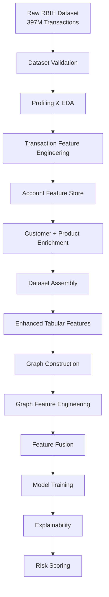
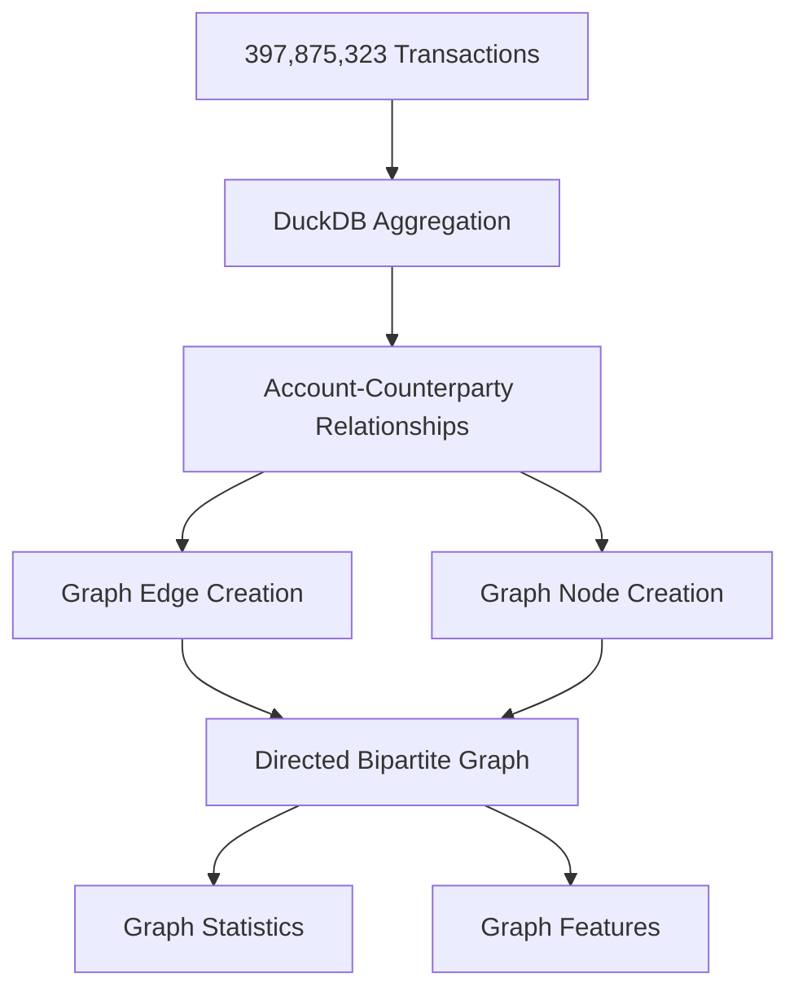
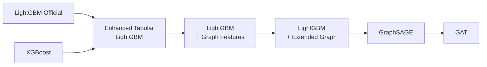
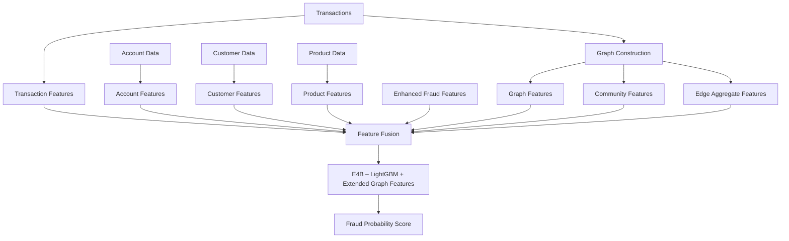

# RBIH Mule Account Detection

## Table of Contents
1. Executive Summary
2. Problem Statement
3. Business Objective
4. Dataset Summary
5. Project Architecture
6. Technology Stack
7. Feature Engineering
8. Graph Analytics Pipeline
9. Data Leakage Prevention
10. Dataset Split Strategy
11. Experiments and Results
12. Explainability Findings
13. Model Ranking
14. Installation
15. Repository Structure
16. Key Findings
17. Final Conclusion

---

# Executive Summary

This project develops an end-to-end mule account detection system using large-scale banking transaction data.

The solution combines:
- Transaction Features
- Account Features
- Customer Features
- Product Features
- Enhanced Fraud Features
- Graph Features
- Community Features
- Edge Aggregate Features

The final outcome demonstrates that carefully engineered tabular and graph-derived features outperform Graph Neural Networks (GraphSAGE and GAT) for this dataset while remaining more explainable and easier to deploy.

## Best Model

**E4B – LightGBM + Extended Graph Features**

- ROC-AUC: 0.9312
- PR-AUC: 0.6932
- Precision: 0.7337
- Recall: 0.7537
- F1 Score: 0.7436

---

# Problem Statement

## Evaluating Whether Engineered Graph Intelligence Can Replace Graph Neural Networks for Production Mule Account Detection

Banks and financial institutions require fraud solutions that are:
- Accurate
- Explainable
- Auditable
- Operationally practical

This project investigates whether:

Enhanced behavioural features + engineered graph intelligence

can outperform:

- GraphSAGE
- Graph Attention Networks (GAT)

while remaining easier to deploy and govern.

---

# Business Objective

Predict whether an account is a mule account.

Target:

```text
is_mule

0 = Non-Mule Account
1 = Mule Account
```

Prediction Granularity:

```text
1 Row = 1 Account
```

---

# Dataset Summary

| Dataset | Rows |
|----------|----------:|
| Accounts | 160,153 |
| Customers | 159,416 |
| Labelled Accounts | 96,091 |
| Transactions | 397,875,323 |

Fraud Rate: 2.79%

---

# Project Architecture

```text
Raw Dataset
     ↓
Validation
     ↓
Profiling
     ↓
Feature Engineering
     ↓
Feature Store
     ↓
Dataset Assembly
     ↓
Enhanced Features
     ↓
Graph Construction
     ↓
Graph Feature Engineering
     ↓
Feature Fusion
     ↓
Model Training
     ↓
Explainability
     ↓
Risk Scoring
```

---

# End-to-End Workflow



# Graph Construction Workflow



## Graph Structure

```text
ACCOUNT
      →
COUNTERPARTY
```

Graph Statistics:

```text
Nodes:
301,110

Account Nodes:
160,153

Counterparty Nodes:
140,957

Edges:
3,254,788
```
# Experiment Progression



## Performance Progression

| Model | PR-AUC | F1 |
|---------|---------:|---------:|
| E1 – LightGBM Official | 0.6141 | 0.6658 |
| E2 – XGBoost | 0.6066 | 0.6242 |
| E3 – Enhanced Tabular LightGBM | 0.6639 | 0.7117 |
| E4 – LightGBM + Graph Features | 0.6634 | 0.7311 |
| E4B – LightGBM + Extended Graph Features | **0.6932** | **0.7436** |
| E5 – GraphSAGE | 0.5820 | 0.6446 |
| E6 – GAT | 0.6444 | 0.6715 |

# Final Solution Architecture



## Final Production Pipeline

The final E4B model combines:

### Behavioural Intelligence

```text
Transaction Features

Counterparty Features

Channel Features

MCC Features

Velocity Features
```

### Customer Intelligence

```text
Customer Age

Relationship Tenure

KYC Behaviour

Digital Banking Usage
```

### Account Intelligence

```text
Account Status

Balance Behaviour

Branch Characteristics
```

### Graph Intelligence

```text
Community Behaviour

Network Connectivity

Bridge Behaviour

Relationship Strength
```

This architecture delivered the strongest performance observed in the project:

```text
ROC-AUC   = 0.9312

PR-AUC    = 0.6932

Precision = 0.7337

Recall    = 0.7537

F1        = 0.7436
```

# Technology Stack

## Data
- DuckDB
- Pandas
- NumPy

## ML
- LightGBM
- XGBoost

## Graph Analytics
- NetworkX
- PyTorch Geometric

## Explainability
- SHAP

---

# Feature Engineering

## Enhanced Tabular Features

- counterparty_entropy
- top_counterparty_transaction_share
- top_counterparty_volume_share
- avg_txn_per_day
- channel_entropy
- dominant_mcc_ratio

## Graph Features

Core:
- out_degree
- weighted_degree
- pagerank
- neighbor_count
- community_id
- community_size
- two_hop_neighbor_count
- neighbor_degree_mean
- neighbor_degree_max
- betweenness_centrality
- community_activity_score

Community:
- community_avg_txn_count
- community_avg_credit_amount
- community_avg_debit_amount
- community_avg_txn_per_day

Edge:
- edge_txn_count_mean
- edge_txn_count_max
- edge_txn_count_std
- edge_volume_mean
- edge_volume_max
- edge_volume_std
- edge_amount_mean
- edge_amount_max

---

# Graph Analytics Pipeline

Graph Type:

```text
ACCOUNT → COUNTERPARTY
```

Graph Statistics:

```text
Nodes: 301,110
Accounts: 160,153
Counterparties: 140,957
Edges: 3,254,788
```

---

# Data Leakage Prevention

Removed from training:

```text
mule_flag_date
alert_reason
flagged_by_branch
```

---

# Dataset Split Strategy

Official frozen split:

```text
Train      70%
Validation 15%
Test       15%
```

Files:

```text
train_ids.csv
val_ids.csv
test_ids.csv
```

---

# Experiments and Results

| Model | ROC-AUC | PR-AUC | F1 |
|------|------:|------:|------:|
| E1 LightGBM Official | 0.9221 | 0.6141 | 0.6658 |
| E2 XGBoost | 0.9211 | 0.6066 | 0.6242 |
| E3 Enhanced Tabular LightGBM | 0.9247 | 0.6639 | 0.7117 |
| E4 LightGBM + Graph | 0.9236 | 0.6634 | 0.7311 |
| E4B LightGBM + Extended Graph | 0.9312 | 0.6932 | 0.7436 |
| E5 GraphSAGE | 0.9114 | 0.5820 | 0.6446 |
| E6 GAT | 0.9253 | 0.6444 | 0.6715 |

---

# Explainability Findings

Graph vs Tabular Contribution:

```text
Tabular Features : 71.1%
Graph Features   : 28.9%
```

Feature Family Contribution:

```text
Graph Features        32.1%
Transaction Features  23.1%
Enhanced Features     14.9%
Customer Features     14.6%
Account Features      11.2%
Product Features       4.2%
```

Top Features:
- days_since_kyc
- edge_amount_mean
- account_age_days
- dominant_mcc_ratio
- edge_txn_count_std
- betweenness_centrality
- channel_entropy
- avg_txn_per_day
- unique_counterparties
- neighbor_degree_mean

---

# Model Ranking

1. E4B – LightGBM + Extended Graph Features
2. E3 – Enhanced Tabular LightGBM
3. E4 – LightGBM + Graph Features
4. E6 – GAT
5. E1 – LightGBM Official
6. E2 – XGBoost
7. E5 – GraphSAGE

---

# Installation

```powershell
python -m venv .venv
.\.venv\Scripts\activate
pip install -r requirements.txt
```

Optional GNN environment:

```powershell
python -m venv .venv_gnn
.\.venv_gnn\Scripts\activate
pip install torch torchvision torchaudio
pip install torch-geometric
pip install pandas numpy scikit-learn pyarrow matplotlib shap seaborn
```

---

# Repository Structure

```text
configs/
data/
docs/
models/
results/
src/
archive/
```

---

# Key Findings

1. Enhanced tabular features produced the largest gain.
2. Graph-derived features produced additional meaningful gains.
3. Community and edge aggregate features were highly predictive.
4. GraphSAGE did not outperform engineered graph features.
5. GAT improved over GraphSAGE but did not exceed E4B.

---

# Final Conclusion

The strongest solution for this dataset was:

LightGBM + Extended Graph Features (E4B)

This approach outperformed:
- XGBoost
- GraphSAGE
- GAT

while providing superior explainability, governance, and deployment suitability for banking environments.

## Final Winning Model

```text
ROC-AUC   = 0.9312
PR-AUC    = 0.6932
Precision = 0.7337
Recall    = 0.7537
F1        = 0.7436
Recall@500  = 0.8085
Recall@1000 = 0.8781
```


