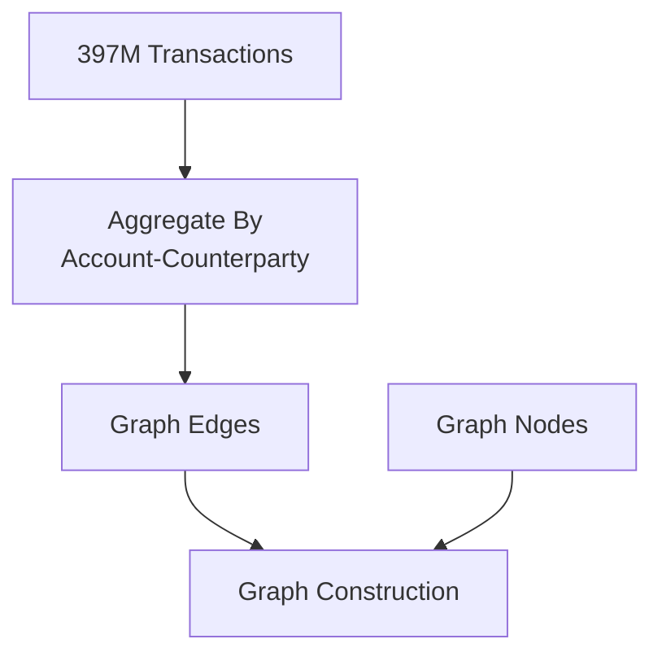
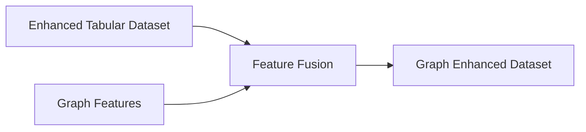
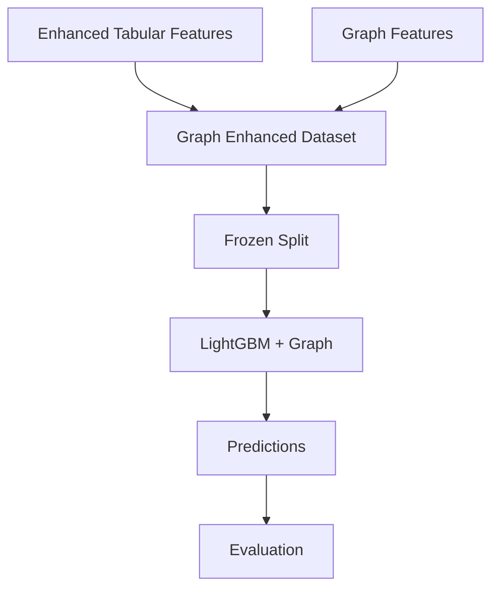
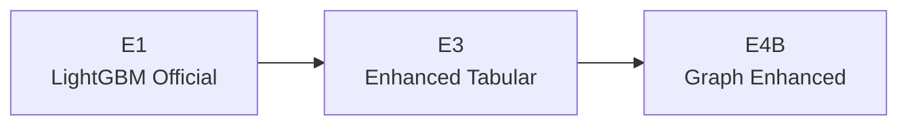

# LightGBM + Graph Features Methodology

## 1. Objective

Enhance the best tabular LightGBM model using graph-derived network features.

---

# 2. Graph Construction

## Graph Type

Directed Bipartite Graph

```text
ACCOUNT
     →
COUNTERPARTY
```

---

## Graph Statistics

```text
Nodes: 301,110

Account Nodes:      160,153

Counterparty Nodes: 140,957

Edges: 3,254,788
```

---

# 3. Graph Creation Workflow



---

# 4. Graph Feature Engineering

## Graph Features

### Degree Features

```text
out_degree

weighted_degree

neighbor_count
```

---

### Network Centrality

```text
pagerank

betweenness_centrality
```

---

### Community Features

```text
community_id

community_size

community_activity_score
```

---

### Neighbor Features

```text
neighbor_degree_mean

neighbor_degree_max

two_hop_neighbor_count
```

---

### Community Aggregate Features

```text
community_avg_txn_count

community_avg_credit_amount

community_avg_debit_amount

community_avg_txn_per_day
```

---

### Edge Aggregate Features

```text
edge_txn_count_mean

edge_txn_count_max

edge_txn_count_std

edge_volume_mean

edge_volume_max

edge_volume_std

edge_amount_mean

edge_amount_max
```

---

# 5. Feature Fusion

Tabular features and graph features are merged together.



---

# 6. Graph Enhanced Dataset

Output:

```text
baseline_dataset_graph_extended.parquet
```

Shape:

```text
96,091 Rows

112 Features
```

---

# 7. Training Workflow



---

# 8. LightGBM Configuration

```python
LGBMClassifier(

    n_estimators=500,

    learning_rate=0.05,

    num_leaves=63,

    class_weight="balanced",

    random_state=42
)
```

Configuration intentionally kept identical to the tabular model to isolate the effect of graph features.

---

# 9. Results

## E4B - LightGBM + Extended Graph Features

```text
ROC-AUC   = 0.9312

PR-AUC    = 0.6932

Precision = 0.7337

Recall    = 0.7537

F1 Score  = 0.7436
```

### Recall@K

```text
Recall@100   = 19.65%

Recall@500   = 80.85%

Recall@1000  = 87.81%
```

---

# 10. Feature Importance

Most Valuable Graph Features

```text
betweenness_centrality

neighbor_degree_mean

community_activity_score

community_id

community_size
```

These network features captured:

```text
Fraud Ring Participation

Network Bridges

Community Behaviour

Relationship Intensity
```

---

# 11. Model Comparison



| Metric | E3 | E4B |
|----------|----------:|----------:|
| ROC-AUC | 0.9247 | 0.9312 |
| PR-AUC | 0.6639 | 0.6932 |
| Precision | 0.7022 | 0.7337 |
| Recall | 0.7214 | 0.7537 |
| F1 | 0.7117 | 0.7436 |

---

# 12. Conclusion

Graph-derived features significantly improved fraud detection performance.

The graph layer successfully introduced:

```text
Community Behaviour

Network Connectivity

Bridge Detection

Relationship Strength
```

which are difficult to capture using transaction features alone.

The graph-enhanced LightGBM model became the best-performing tabular model in the project and serves as the benchmark for:

```text
GraphSAGE

GAT
```