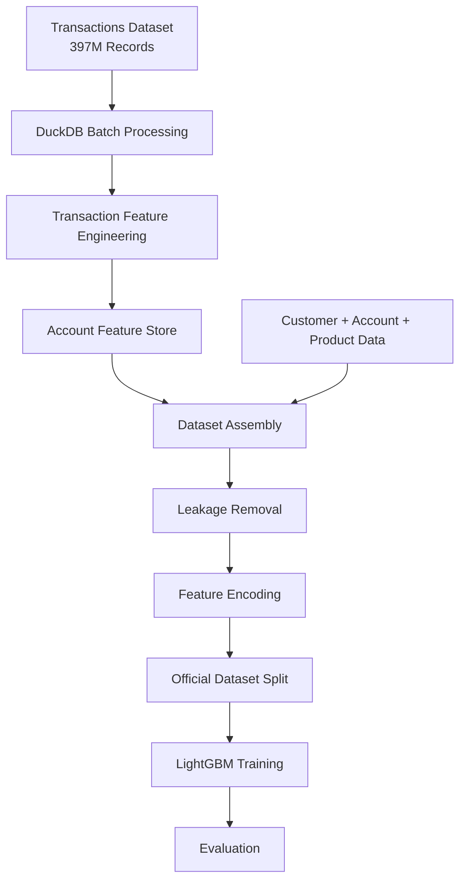
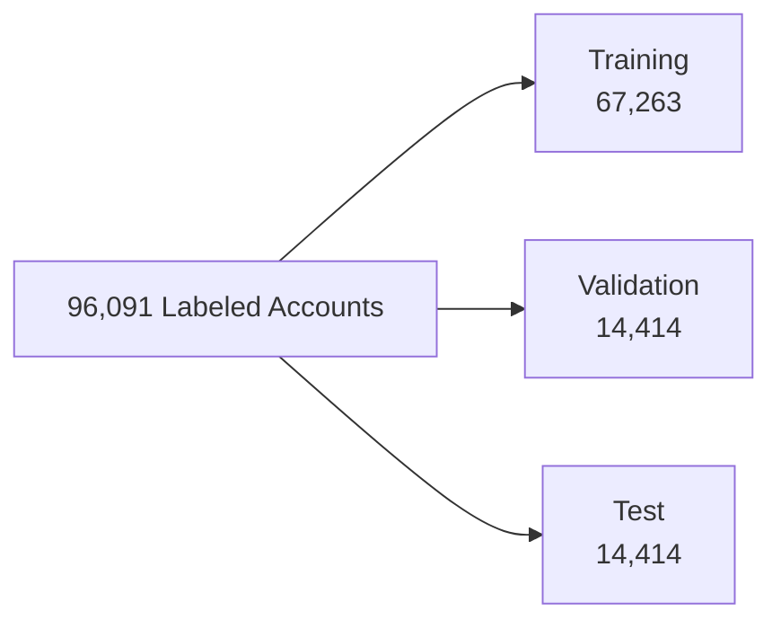
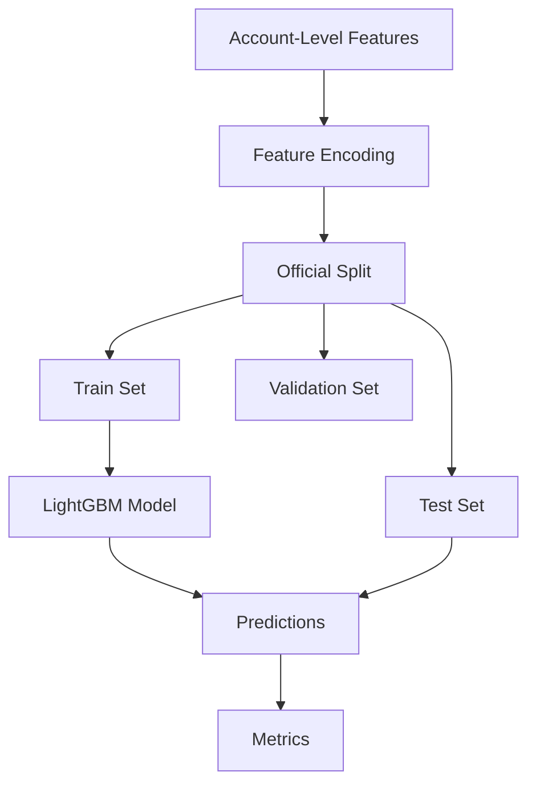

# LightGBM Mule Account Detection - Implementation Methodology

## 1. Objective

The objective of this model is to identify mule accounts at account level using transaction behavior, account metadata, customer demographics, and banking product relationships.

### Target

```text
is_mule

0 = Non-Mule Account
1 = Mule Account
```

### Prediction Granularity

```text
1 Row = 1 Account
```

---

# 2. Dataset Overview

## Source Datasets

### Account Data

```text
accounts.parquet
accounts-additional.parquet
```

### Customer Data

```text
customers.parquet
demographics.parquet
```

### Product Data

```text
product_details.parquet
```

### Transaction Data

```text
397,875,323 Transactions
```

### Labels

```text
train_labels.parquet

96,091 Labeled Accounts
```

Fraud Rate:

```text
2.79%
```

---

# 3. Dataset Processing Architecture



---

# 4. Feature Engineering

## Transaction Features

Generated using DuckDB aggregation.

Examples:

```text
txn_count
credit_count
debit_count

total_credit_amount
total_debit_amount

avg_credit_amount
avg_debit_amount

negative_txn_count
negative_txn_ratio

unique_counterparties

UPC_count
UPD_count

active_days
```

---

## Enhanced Tabular Features

New fraud-specific features added:

```text
counterparty_entropy

top_counterparty_transaction_share

top_counterparty_volume_share

avg_txn_per_day

channel_entropy

dominant_mcc_ratio
```

---

## Account Features

Generated from:

```text
accounts.parquet
```

Examples:

```text
account_status

avg_balance

monthly_avg_balance

quarterly_avg_balance

daily_avg_balance
```

---

## Customer Features

Generated from:

```text
customers.parquet

demographics.parquet
```

Examples:

```text
customer_age_days

relationship_age_days

days_since_kyc

days_since_mobile_update
```

---

## Product Features

Generated from:

```text
product_details.parquet
```

Examples:

```text
loan_sum

cc_sum

od_sum

sa_sum

ka_sum
```

---

# 5. Leakage Prevention

Removed:

```text
mule_flag_date
alert_reason
flagged_by_branch
```

Reason:

```text
Post-investigation information
```

---

# 6. Official Split Strategy



Frozen:

```text
train_ids.csv

val_ids.csv

test_ids.csv
```

---

# 7. LightGBM Training

## Configuration

```python
LGBMClassifier(

    n_estimators=500,

    learning_rate=0.05,

    num_leaves=63,

    class_weight="balanced",

    random_state=42
)
```

---

## Training Workflow



---

# 8. Official Results

## Enhanced Tabular LightGBM (E3)

```text
ROC-AUC   = 0.9247

PR-AUC    = 0.6639

Precision = 0.7022

Recall    = 0.7214

F1 Score  = 0.7117
```

### Recall@K

```text
Recall@100   = 20.40%

Recall@500   = 77.36%

Recall@1000  = 85.57%
```

---

# 9. Most Important Features

```text
days_since_kyc

dominant_mcc_ratio

account_age_days

channel_entropy

avg_txn_per_day

top_counterparty_transaction_share

counterparty_entropy
```

---

# 10. Conclusion

The LightGBM model successfully transformed:

```text
397,875,323 transactions
```

into:

```text
96,091 account-level observations
```

and achieved strong performance using realistic banking transaction, customer, account, and product features.